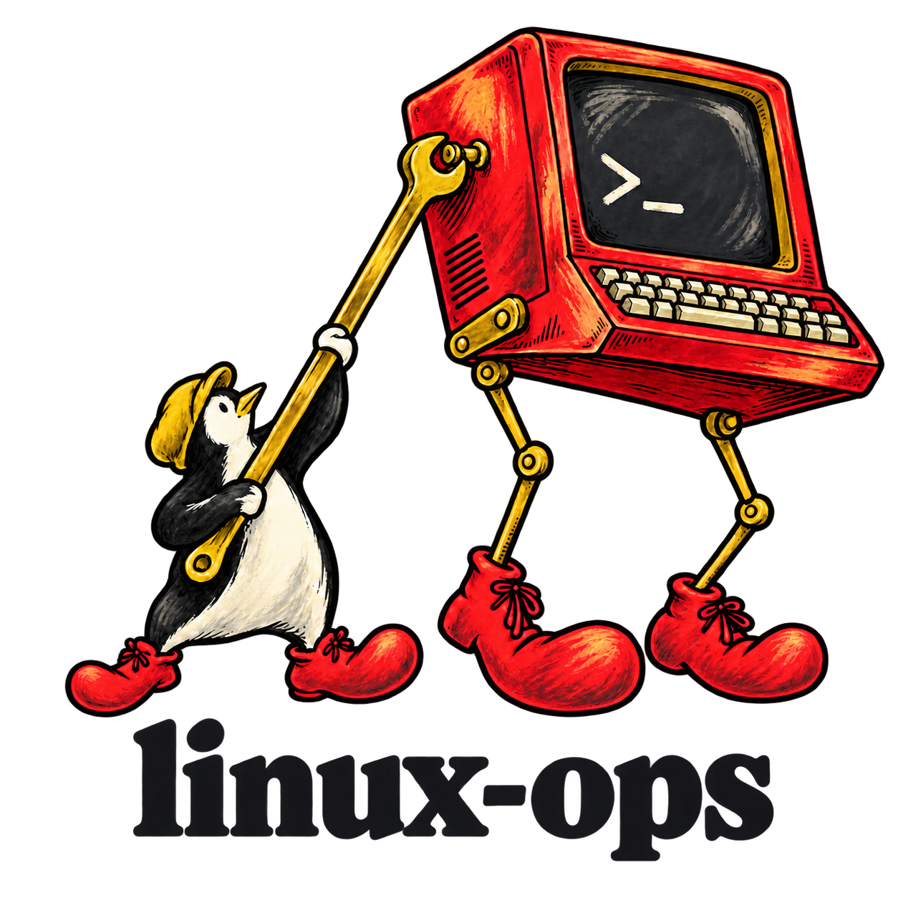

<div align="center">

<picture>
  <source media="(prefers-color-scheme: dark)" srcset="docs/branding/linux-ops-surreal-textured-dark.png">
  <source media="(prefers-color-scheme: light)" srcset="docs/branding/linux-ops-surreal-textured-light.png">
  
</picture>

### Your agent for Linux system administration.

[](#install)
[](#install)
[](#install)
[](LICENSE)
[](#install)

**English** · [Português (Brasil)](docs/readme/README_pt-BR.md)

[Install](#install) · [What it does](#what-it-does) · [Your data](#your-data) · [Supported systems](#supported-systems) · [Development](#development)

</div>

---

**linux-ops** lets your agent administer the Linux machine it runs on: the agent records each change with the command that undoes it, a hook logs the commands it ran in case it forgets, and it can tell you what changed since things last worked.

> Early version, 0.3.0. Measured so far on two scripted cases with Claude Code (undoing a day-old change, and saying what changed); other agents and distributions are not benchmarked yet.

Models already know `apt` and `systemctl`. What they do not have is memory of this machine: what an earlier session changed, how to reverse it, and what the system looked like before. That is what linux-ops keeps.

## Install

**Claude Code**

```bash
claude plugin marketplace add pv-ca/linux-ops && claude plugin install linux-ops@linux-ops
```

That installs it for every project. Add `--scope project` to the second command to install it only in the current project.

**Codex**

```bash
codex plugin marketplace add pv-ca/linux-ops && codex plugin add linux-ops@linux-ops
```

Codex asks you to review the hooks the first time.

**Antigravity**

```bash
agy plugin install https://github.com/pv-ca/linux-ops
```

For one project only, clone the repository into `.agents/plugins/linux-ops` in that project.

**Any other agent** (Cursor, OpenCode, Gemini CLI and the rest)

```bash
npx skills add pv-ca/linux-ops
```

Add `-g` to install it for every project. This route installs the skill without the hooks, so the agent writes the journal itself.

With the plugin installed, every shell command the agent runs is logged on your machine, in every project it is enabled for. [Your data](#your-data) says what is kept, where, and how to turn it off or remove it.

Then ask "what changed on this machine in the last two weeks?", or run `/linux-ops:setup` in Claude Code. The answer comes from the package manager's own record, so it works on the first day.

The same folder serves the three agents: the skill and its scripts are shared, and each agent has its own thin manifest and hook file. The install commands were tested for the three; a live session has run in Claude Code and Antigravity, not yet in Codex.

## What it does

| Piece | What you get |
| --- | --- |
| Journal | Each change is recorded with what it was, the command that undoes it and the backup it took. With the plugin, a hook also logs every command the agent runs, and the next session is told when commands were logged with no change recorded, so the record does not depend on the model remembering. |
| Snapshots | System packages, Flatpak and Snap, kernel and its command line, loaded modules, Secure Boot state, enabled units (system and user), user and group names, a hash of each file in `/etc` and in `~/.config`, and dconf. Taken at most once a day at session start. Comparing two of them answers "what changed?" from what is on disk, including changes nobody announced. |
| Undo plan | One command gives the agent the active changes with their undo commands, the snapshot from before them and what still differs from it, so undoing costs few steps. The scripts never run an undo themselves. |
| History | What the package manager itself recorded, so "what changed last week?" has an answer on the day you install linux-ops, before any snapshot exists. |
| Host profile | Distribution family, package manager, session type, SELinux or AppArmor, and whether the system is one the skill may change. Shown to the agent at session start. |

In Claude Code a panel says what was changed on this machine, latest change first, each with an **Undo** button that only fills the prompt for you to send. You choose where it lives with `/linux-ops-panel chip|bar|side|off`, and the choice is kept for later sessions:

- `chip` (default): one quiet label under the prompt, "linux-ops · 2 changes"; a click opens a two-line card above the prompt with the machine, the latest change and its Undo.
- `bar`: one line above the prompt with the latest change and its Undo.
- `side`: a panel beside the chat with the machine (distribution, kernel, desktop, package manager, init, SELinux or AppArmor), every change under its day, the age of the last snapshot and a button to take one now.
- `off`: nothing but a status entry while there are changes.

It reads the journal directly and spends no model tokens.

Commands, in Claude Code:

- `/linux-ops:undo`: reverse a recorded change.
- `/linux-ops:changes`: what changed on this machine since it last worked.
- `/linux-ops:improve`: make the machine better for what you do with it. The agent asks what you want, measures, recommends changes for this hardware and distribution, applies the ones you pick with their undo, and measures again.
- `/linux-ops:verify`: check that everything set up here still works, for example after an update.
- `/linux-ops:preflight`: check whether the machine is ready for an update or a distribution upgrade.
- `/linux-ops:export`: what has been set up here, written so it can be reproduced elsewhere.
- `/linux-ops:rescue`: a one-page sheet for the day the machine will not boot and no agent can reach it.
- `/linux-ops:setup`: first snapshot, what changed in the last two weeks, and permission rules so read-only inspection stops asking.
- `/linux-ops:data`: what linux-ops keeps and where; erase it, or turn the command log off.

In the other agents, ask for the same thing in words; the skill routes to the same scripts.

The scripts are in `skills/linux-ops/scripts/` and need Python 3.6+ with the standard library only. `detect_host.py` and `state.py` read the system; `journal.py` and `state.py` write only under `~/.local/state/linux-ops/`.

linux-ops compares states and keeps undo commands. It does not restore the system the way a filesystem snapshot does, and a snapshot of either kind is not a backup. An undo command is written by the agent and nothing checks it: read it before it runs.

## Your data

| | |
| --- | --- |
| What is logged | Every shell command the agent runs, and each file it edits outside a Git repository, in every project the plugin is enabled for. Not the output of commands. |
| What else is kept | The changes the agent records, and up to 90 snapshots (about 1 MB each, one a day at most). |
| Where | `~/.local/state/linux-ops/<machine-id>/`, readable only by you. `journal.py where` prints the directory and its size. |
| For how long | The journal is never trimmed. Snapshots beyond the newest 90 are deleted. |
| Who sees it | The scripts send nothing anywhere. What your agent reads from the journal goes to your model provider, like any other tool output. |
| Turn the log off | `LINUX_OPS_NO_LOG=1` stops the automatic command log and keeps only the changes the agent records. |
| Remove everything | Uninstall the plugin with your agent's own command, then delete `~/.local/state/linux-ops/`. |

Credentials are masked before a command is written: values assigned to or passed with `password`, `token`, `secret`, `api key` or `authorization`, passwords and tokens inside URLs, private keys, and the password arguments of common tools (`curl -u`, `sshpass`, `mysql`, `nmcli`, `chpasswd`, `docker login`, `sudo -S` and a few more). The mask is a courtesy, not a guarantee: a secret in a form it does not know is stored as typed.

## Supported systems

| Level | Systems |
| --- | --- |
| Tier 1, tested in CI | Fedora, Debian, Ubuntu, Arch Linux, openSUSE Tumbleweed, openSUSE Leap |
| Derivative, untested | Distributions that declare one of those families in `ID_LIKE`, such as Rocky, Linux Mint or Manjaro |
| Everything else | Alpine, Void, Gentoo, NixOS and any other distribution. Detection and snapshots are tested in CI on Alpine; nothing else here is tested. The profile carries a note, and the agent confirms names on the host. |

It is built to work on any distribution, and nothing in it refuses one. Where the usual commands would be wrong, the profile tells the agent how that system is changed: image-based systems (Fedora Silverblue, Kinoite, Bazzite, openSUSE MicroOS and Aeon) through their own layering tool, NixOS through its configuration, hosts without systemd through their own init. The package history reads rpm, dpkg and pacman only. [docs/CONTRACT.md](docs/CONTRACT.md) states the rules.

## Development

```console
$ python3 -m pytest -q tests     # unit tests against fake host trees
$ tests/containers.sh            # the scripts inside each tier 1 image and Alpine
```

`tests/containers.sh` needs Docker or Podman and network access; set `ENGINE` to choose between them.

## License

[MIT](LICENSE)
