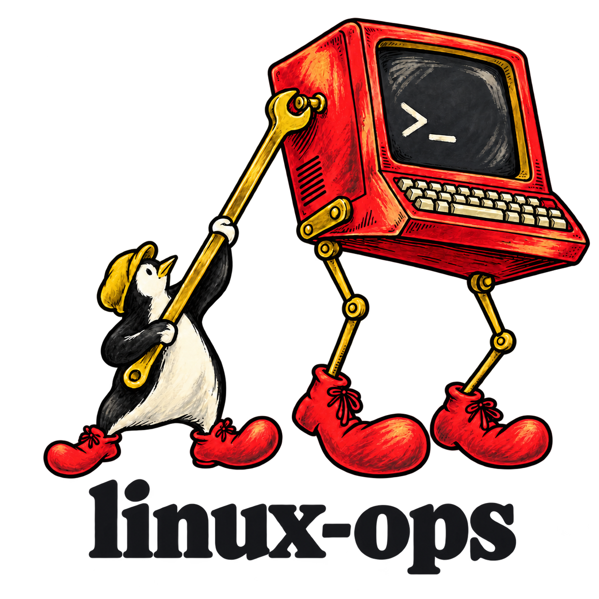

<div align="center">

<picture>
  <source media="(prefers-color-scheme: dark)" srcset="docs/branding/linux-ops-surreal-textured-dark.png">
  <source media="(prefers-color-scheme: light)" srcset="docs/branding/linux-ops-surreal-textured-light.png">
  
</picture>

### Your agent for Linux system administration.

[](#install)
[](#install)
[](LICENSE)
[](#install)

**English** · [Português (Brasil)](docs/readme/README_pt-BR.md)

[Install](#install) · [What it does](#what-it-does) · [Supported systems](#supported-systems) · [Development](#development)

</div>

---

**linux-ops** helps your agent administer the Linux machine it runs on. It supplies a host profile, a method for reversible changes and clear limits on unsupported systems.

> Early draft, version 0.1.0.

Models already know `apt` and `systemctl`. What they lack is the state of this particular machine and the discipline to change it reversibly, so that is what the skill supplies.

## Install

Copy `skills/linux-ops` into your agent's skills directory, for example `~/.claude/skills/linux-ops` for Claude Code or `~/.agents/skills/linux-ops` for Codex.

## What it does

- `skills/linux-ops/SKILL.md`: the method, covering evidence, change transactions and the confirmation boundary.
- `skills/linux-ops/scripts/detect_host.py`: prints the host profile as JSON. It reads the host and changes nothing. Python 3.6+, standard library only.

```console
$ python3 skills/linux-ops/scripts/detect_host.py --compact
{"change_model": "imperative", "environment": "physical", "family": "fedora", "init": "systemd", "mode": "read-write", "package_manager": "dnf", ...}
```

## Supported systems

| Level | Systems |
| --- | --- |
| Tier 1, tested in CI | Fedora, Debian, Ubuntu, Arch Linux, openSUSE Tumbleweed, openSUSE Leap |
| Derivative, untested | Distributions that declare one of those families in `ID_LIKE`, such as Rocky, Linux Mint or Manjaro |
| Everything else | Read-only mode: the skill inspects and advises, and makes no changes |

Image-based systems (Fedora Silverblue and Kinoite, openSUSE MicroOS and Aeon), NixOS and hosts without systemd are held in read-only mode. [docs/CONTRACT.md](docs/CONTRACT.md) states the rules.

## Development

```console
$ python3 -m pytest -q tests     # unit tests against fake host trees
$ tests/containers.sh            # the detector inside each tier 1 container image
```

`tests/containers.sh` needs Docker or Podman and network access; set `ENGINE` to choose between them.

## License

[MIT](LICENSE)
