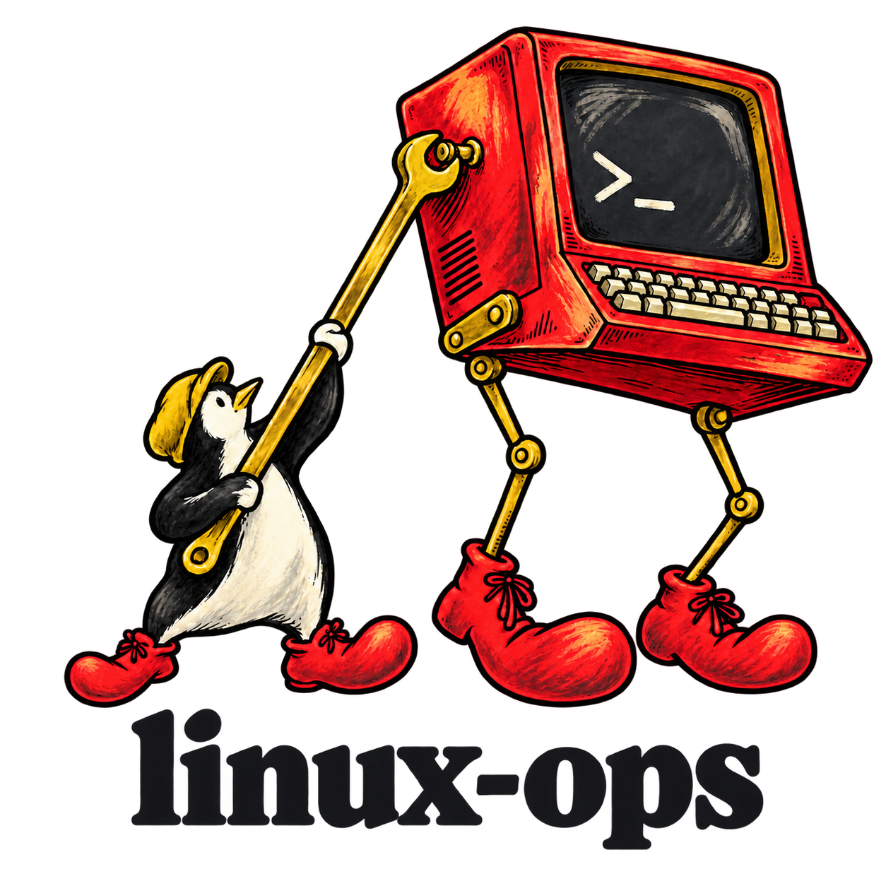

<div align="center">

<picture>
  <source media="(prefers-color-scheme: dark)" srcset="../../docs/branding/linux-ops-surreal-textured-dark.png">
  <source media="(prefers-color-scheme: light)" srcset="../../docs/branding/linux-ops-surreal-textured-light.png">
  
</picture>

### Seu agente para administrar o Linux.

[](#instalação)
[](#instalação)
[](#instalação)
[](../../LICENSE)
[](#instalação)

[English](../../README.md) · **Português (Brasil)**

[Instalação](#instalação) · [O que faz](#o-que-faz) · [Seus dados](#seus-dados) · [Sistemas suportados](#sistemas-suportados) · [Desenvolvimento](#desenvolvimento)

</div>

---

**linux-ops** deixa seu agente administrar a máquina Linux em que ele roda: o agente registra cada alteração com o comando que a desfaz, um hook grava os comandos que ele rodou caso ele esqueça, e ele sabe dizer o que mudou desde que tudo funcionava.

> Versão inicial, 0.3.0. Medida até agora em dois casos roteirizados com o Claude Code (desfazer uma alteração do dia anterior e dizer o que mudou); outros agentes e distribuições ainda não foram medidos.

Os modelos já conhecem `apt` e `systemctl`. O que eles não têm é memória desta máquina: o que uma sessão anterior alterou, como reverter e como o sistema estava antes. É isso que a linux-ops guarda.

## Instalação

**Claude Code**

```bash
claude plugin marketplace add pv-ca/linux-ops && claude plugin install linux-ops@linux-ops
```

Isso instala para todos os projetos. Acrescente `--scope project` ao segundo comando para instalar só no projeto atual.

**Codex**

```bash
codex plugin marketplace add pv-ca/linux-ops && codex plugin add linux-ops@linux-ops
```

O Codex pede para você revisar os hooks na primeira vez.

**Antigravity**

```bash
agy plugin install https://github.com/pv-ca/linux-ops
```

Para um projeto só, clone o repositório em `.agents/plugins/linux-ops` dentro dele.

**Qualquer outro agente** (Cursor, OpenCode, Gemini CLI e os demais)

```bash
npx skills add pv-ca/linux-ops
```

Acrescente `-g` para instalar para todos os projetos. Esse caminho instala a skill sem os hooks, então é o próprio agente que grava o diário.

Com o plugin instalado, todo comando de shell que o agente executa fica registrado na sua máquina, em todo projeto em que ele está ativo. [Seus dados](#seus-dados) diz o que fica guardado, onde, e como desligar ou remover.

Depois pergunte "o que mudou nesta máquina nas últimas duas semanas?", ou rode `/linux-ops:setup` no Claude Code. A resposta vem do registro do próprio gerenciador de pacotes, então funciona no primeiro dia.

A mesma pasta serve aos três agentes: a skill e os scripts são compartilhados, e cada agente tem seu manifesto e seu arquivo de hooks, ambos pequenos. Os comandos de instalação foram testados nos três; uma sessão real rodou no Claude Code e no Antigravity, ainda não no Codex.

## O que faz

| Peça | O que você recebe |
| --- | --- |
| Diário | Cada alteração é registrada com o que foi feito, o comando que a desfaz e o backup criado. Com o plugin, um hook também registra todo comando que o agente executa, e a sessão seguinte é avisada quando há comandos registrados sem nenhuma alteração declarada, então o registro não depende de o modelo lembrar. |
| Retratos | Pacotes do sistema, Flatpak e Snap, kernel e sua linha de comando, módulos carregados, estado do Secure Boot, unidades habilitadas (do sistema e do usuário), um hash de cada arquivo em `/etc` e em `~/.config`, e o dconf. Tirados no máximo uma vez por dia no início da sessão. Comparar dois deles responde "o que mudou?" a partir do que está no disco, incluindo mudanças que ninguém anunciou. |
| Plano de reversão | Um comando entrega ao agente as alterações ativas com seus comandos de reversão, o retrato anterior a elas e o que ainda está diferente dele, para que desfazer custe poucos passos. Os scripts nunca executam uma reversão sozinhos. |
| Histórico | O que o próprio gerenciador de pacotes registrou. Assim "o que mudou na semana passada?" tem resposta no dia em que você instala a linux-ops, antes de existir qualquer retrato. |
| Perfil do sistema | Família da distribuição, gerenciador de pacotes, tipo de sessão, SELinux ou AppArmor, e se o sistema é um dos que a skill pode alterar. Aparece para o agente no início da sessão. |

Comandos, no Claude Code:

- `/linux-ops:undo`: reverte uma alteração registrada.
- `/linux-ops:changes`: o que mudou nesta máquina desde que funcionava.
- `/linux-ops:improve`: deixa a máquina melhor para o que você faz com ela. O agente pergunta o que você quer, mede, recomenda mudanças para este hardware e esta distribuição, aplica as que você escolher com o desfazer de cada uma e mede de novo.
- `/linux-ops:verify`: confere se tudo o que foi configurado aqui ainda funciona, por exemplo depois de uma atualização.
- `/linux-ops:preflight`: confere se a máquina está pronta para uma atualização ou um upgrade de versão.
- `/linux-ops-panel`: escolhe onde fica o painel, com `chip`, `bar`, `side` ou `off`; a escolha vale para as próximas sessões. O painel diz o que foi alterado nesta máquina, a alteração mais recente primeiro, cada uma com um botão **Undo** que só preenche o prompt para você enviar. `chip` (padrão) é um rótulo discreto abaixo do prompt, "linux-ops · 2 changes", que ao clicar abre um cartão de duas linhas acima do prompt, com a máquina, a última alteração e o Undo dela; `bar` é uma linha acima do prompt com a última alteração e o Undo dela; `side` é o painel ao lado da conversa, com a máquina (distribuição, kernel, ambiente gráfico, gerenciador de pacotes, init, SELinux ou AppArmor), as alterações por dia, a idade do último retrato e um botão para tirar outro; `off` deixa só uma linha de status enquanto houver alterações. Lê o diário direto e não gasta tokens do modelo.
- `/linux-ops:export`: o que foi configurado aqui, escrito para ser reproduzido em outra máquina.
- `/linux-ops:rescue`: uma folha de uma página para o dia em que a máquina não inicia e nenhum agente a alcança.
- `/linux-ops:setup`: primeiro retrato, o que mudou nas últimas duas semanas, e regras de permissão para que a inspeção somente leitura pare de pedir aprovação.
- `/linux-ops:data`: o que a linux-ops guarda e onde; apagar tudo, ou desligar o registro de comandos.

Nos outros agentes, peça a mesma coisa em palavras; a skill leva aos mesmos scripts.

Os scripts ficam em `skills/linux-ops/scripts/` e requerem Python 3.6 ou superior, só com a biblioteca padrão. `detect_host.py` e `state.py` leem o sistema; `journal.py` e `state.py` gravam apenas em `~/.local/state/linux-ops/`.

A linux-ops compara estados e guarda comandos de reversão. Ela não restaura o sistema como um snapshot de sistema de arquivos faz, e nenhum dos dois tipos de retrato é um backup. O comando de reversão é escrito pelo agente e ninguém o confere: leia antes de deixar rodar.

## Seus dados

| | |
| --- | --- |
| O que é registrado | Todo comando de shell que o agente executa, e cada arquivo que ele edita fora de um repositório Git, em todo projeto em que o plugin está ativo. A saída dos comandos não. |
| O que mais fica guardado | As alterações que o agente declara, e até 90 retratos (cerca de 1 MB cada, no máximo um por dia). |
| Onde | `~/.local/state/linux-ops/<machine-id>/`, legível só por você. `journal.py where` mostra a pasta e o tamanho. |
| Por quanto tempo | O diário nunca é cortado. Retratos além dos 90 mais novos são apagados. |
| Quem vê | Os scripts não enviam nada para lugar nenhum. O que o agente lê do diário vai para o provedor do seu modelo, como qualquer outra saída de ferramenta. |
| Desligar o registro | `LINUX_OPS_NO_LOG=1` desliga o registro automático de comandos e mantém só as alterações que o agente declara. |
| Remover tudo | Desinstale o plugin com o comando do seu agente e apague `~/.local/state/linux-ops/`. |

Credenciais são mascaradas antes de o comando ser gravado: valores atribuídos ou passados a `password`, `token`, `secret`, `api key` ou `authorization`, senhas e tokens dentro de URLs, chaves privadas, e os argumentos de senha de ferramentas comuns (`curl -u`, `sshpass`, `mysql`, `nmcli`, `chpasswd`, `docker login`, `sudo -S` e mais algumas). A máscara é uma cortesia, não uma garantia: um segredo em um formato que ela não conhece fica guardado como foi digitado.

## Sistemas suportados

| Nível | Sistemas |
| --- | --- |
| Tier 1, testados na integração contínua | Fedora, Debian, Ubuntu, Arch Linux, openSUSE Tumbleweed, openSUSE Leap |
| Derivadas, não testadas | Distribuições que declaram uma dessas famílias em `ID_LIKE`, como Rocky, Linux Mint ou Manjaro |
| Demais sistemas | Alpine, Void, Gentoo, NixOS e qualquer outra distribuição. A detecção e os retratos são testados na integração contínua no Alpine; o resto não é testado. O perfil traz um aviso, e o agente confirma os nomes no próprio sistema. |

Foi feita para funcionar em qualquer distribuição, e nada nela recusa alguma. Onde os comandos comuns estariam errados, o perfil diz ao agente como aquele sistema é alterado: sistemas baseados em imagens (Fedora Silverblue, Kinoite, Bazzite, openSUSE MicroOS e Aeon) pela ferramenta de camadas deles, o NixOS pela configuração, máquinas sem systemd pelo init que usam. O histórico de pacotes lê apenas rpm, dpkg e pacman. As regras estão em [docs/CONTRACT.md](../CONTRACT.md).

## Desenvolvimento

```console
$ python3 -m pytest -q tests     # testes unitários com sistemas de arquivos simulados
$ tests/containers.sh            # os scripts em cada imagem Tier 1 e no Alpine
```

`tests/containers.sh` requer Docker ou Podman e acesso à rede; use `ENGINE` para escolher entre eles.

## Licença

[MIT](../../LICENSE)
